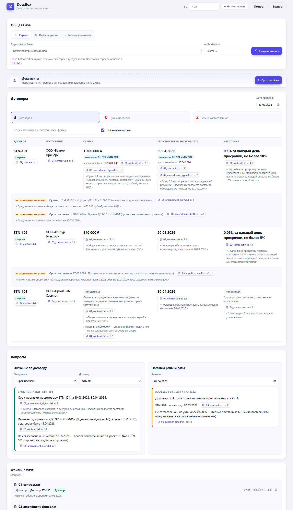
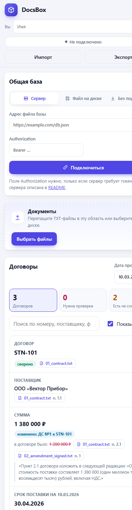

# DocsBox

Сверка условий договоров поставки в браузере. По загруженным TXT-файлам договоров, допсоглашений и писем строится таблица: поставщик, сумма, срок поставки на выбранную дату, неустойка. У каждого значения есть файл, цитата и переход к абзацу в исходном документе.

Страница не хранит документы. Они лежат в общем файле базы на вашем сервере, диске или в папке, и несколько специалистов работают с одним файлом одновременно.

[](https://github.com/Zilk102/docs-box/actions/workflows/tests.yml)


**Открыть:** https://zilk102.github.io/docs-box/ (кнопка «Открыть пример» загружает учебные документы)





## Возможности

- Загрузка нескольких TXT-файлов кнопкой «Выбрать файлы» или перетаскиванием (UTF-8 и Windows-1251).
- Условия меняет только допсоглашение, подписанное обеими сторонами и вступившее в силу к дате проверки. Письма, проекты и допсоглашения, которые вступят в силу позже, показываются отдельно как «не согласовано».
- У суммы и срока: имя файла, точная цитата, переход к абзацу с подсветкой. Если значение изменено, указан документ-источник и прежнее значение.
- Если значения в тексте нет, показывается «нет данных». Аванс и внутренний лимит бюджета не принимаются за стоимость договора и выводятся с пояснением.
- Спорные случаи (два разных значения, расхождение суммы цифрами и прописью, допсоглашение без даты вступления в силу, другой поставщик) помечаются «нужна проверка».
- Фильтры по статусу, поиск, переключатель цитат, вопросы о значении поля и о договорах со сроком раньше заданной даты.
- Интерфейс адаптирован под телефон, планшет и десктоп.

## Запуск

Онлайн: ссылка выше. Локально (Node 18+, зависимостей нет):

```bash
git clone https://github.com/Zilk102/docs-box.git
cd docs-box
npm start
```

Страница откроется на http://localhost:8080. Тесты: `npm test`.

Пример: нажмите «Открыть пример», дата проверки 10.03.2026. STN-101: срок 30.04.2026 (изменён допсоглашением №1, проект №2 не учитывается). STN-102: сумма 840 000 ₽ (252 000 ₽ — аванс). STN-103: сумма — нет данных, лимит 600 000 ₽ не принят.

## Общая база

«База» — один JSON-файл с исходными текстами документов. Результаты всегда пересчитываются из текстов.

| Способ | Как подключить |
|---|---|
| Сервер | Вкладка «Сервер», адрес файла `https://…/db.json`, при необходимости заголовок Authorization. Ссылка вида `…/#db=<адрес>` подключает коллегу сразу. |
| Файл на диске или в сетевой папке | Вкладка «Файл на диске» (Chrome и Edge, File System Access API). |
| Без подключения | Кнопки «Импорт» и «Экспорт» в шапке. Импорт добавляет документы к текущим, а не заменяет их. |

**Что запоминает браузер.** Только способ подключения: адрес сервера (localStorage) или выбранный файл (IndexedDB), чтобы после перезагрузки страницы подключение восстановилось. Документы, результаты и токен в постоянное хранилище не попадают. Authorization сохраняется на время жизни вкладки (sessionStorage). Кнопка «Отключиться» стирает запомненное подключение. Файл на диске после перезагрузки может потребовать нажатия «Переподключить»: браузер запрашивает доступ только по клику.

**Одновременная работа.** Записи в базе содержат метки времени. Слияние объединяет документы по идентификатору (хэш имени и текста); при совпадении побеждает более свежая запись; удаление хранится как отметка об удалении. Запись условная (`If-Match`): если файл успели изменить, клиент перечитывает его, сливает и повторяет запись. Файл с тем же именем и другим текстом считается новой версией и заменяет прежнюю. Изменения коллег подтягиваются каждые 5 секунд.

### Сервер для общей базы

Нужен HTTP-сервер, который отдаёт и принимает один файл, поддерживает `ETag`, `If-Match`, `If-None-Match` и разрешает CORS для адреса сайта. Подходят WebDAV (Nextcloud, nginx `dav`) и референсный сервер из `server/` (без зависимостей):

```bash
TOKEN=секрет ALLOW_ORIGIN=https://zilk102.github.io DB_FILE=./data/db.json node server/server.mjs
```

В приложении: адрес `http://localhost:8787/db.json`, Authorization `Bearer секрет`. Если страница открыта по HTTPS, сервер тоже должен работать по HTTPS (исключение — localhost).

## Как устроено

```
TXT → parse.js → кандидаты значений, статус, даты, стороны → resolve.js → таблица и ответы
        ↑ fields.js (правила полей)
db.js ↔ sync/ (HTTP с ETag, файл, импорт/экспорт) ↔ общий файл базы
```

- `src/core` — разбор и сверка, без DOM; `fields.js` — реестр условий (новое условие добавляется описанием одного поля).
- `src/sync` — хранилища с общим интерфейсом `read/write` и цикл «прочитать, слить, записать».
- `src/ui` — интерфейс без сборки и зависимостей: состояние, подключение, отрисовка, действия.
- `server/server.mjs` — референсный сервер; `tests/` — 42 теста (`node:test`).

Извлечение построено на правилах, без LLM и без сети: документ делится на предложения с точными смещениями, каждое проверяется правилами поля.

## Разработка с CodeMaps

Проект писался с MCP-сервером CodeMaps: перед правками он строил граф зависимостей, после правок `validate_architecture_changes` проверял сложность функций, размер модулей и нарушения SOLID, а `check_documentation` проверял заголовки файлов и комментарии к функциям. Текущее состояние по его отчёту: health score 91 (A), SOLID 98, документированных символов 100%, функций с высокой сложностью, раздутых модулей и дублей нет. Остаточные замечания инструмента: один изолированный узел и неопределённый слой у части узлов (слои в конфигурации не заданы). Конфигурация лежит в `.codemaps/`, правила для агентов — в `AGENTS.md`.

## Ограничения

- Только TXT и только рубли. OCR, PDF и DOCX не поддерживаются.
- Распознаётся формат «договор плюс допсоглашение с изложением пункта целиком», как в примерах. Нетиповые формулировки дают «нужна проверка» или «нет данных».
- Суммы из спецификаций и приложений не читаются, пока приложение не загружено как TXT.
- Файловое хранилище: между проверкой версии и записью остаётся окно в миллисекунды; конфликт разрешается слиянием при следующей синхронизации.
- Опрос раз в 5 секунд, push-уведомлений нет. Права доступа задаёт сервер (токен), ролей внутри базы нет.

---

## Записка Product Owner

**Пользователь.** Специалист по закупкам, который сверяет условия поставки и не хочет перечитывать пачку документов. Каждое значение нужно проверять по источнику за несколько секунд.

**Пять вопросов клиенту**
1. Какие форматы приходят на практике: PDF-сканы, DOCX, выгрузки из 1С?
2. Где хранится статус подписания (СЭД, 1С, почта) и есть ли он в метаданных, а не только в тексте?
3. Какие ещё условия нужны в таблице (НДС, этапы поставки, валюта, гарантия) и в каком порядке важности?
4. Что хуже: пропущенное изменение или лишнее «нужна проверка»?
5. Можно ли хранить тексты договоров на внешнем сервере, кто и что вправе видеть?

**Допущения.** Дата проверки задаётся пользователем и общая для базы. Допсоглашение действует с указанной даты вступления в силу, без даты — «нужна проверка». Имена файлов и дата загрузки приоритет не определяют. При нескольких допсоглашениях побеждает более поздняя дата вступления в силу. Документы соответствуют формату примеров.

**Метрики**
- Доля значений, принятых без правки, на размеченной выборке; отдельно доля ложных «уверенных» значений (цель — ноль).
- Время от загрузки до проверенного значения и доля договоров, закрытых без чтения исходника целиком.

**Ключевые решения и компромиссы**
1. Правила вместо LLM: результат детерминирован, объясним цитатой, работает офлайн и бесплатно; цена — хрупкость к нетиповым формулировкам, поэтому неясное помечается «нужна проверка».
2. Статический клиент и общий файл вместо бэкенда: нет сервера приложения и хранения данных в нём; цена — права и аудит остаются на стороне сервера файла, размер базы ограничен одним JSON.
3. База хранит исходные тексты, а не результаты, слияние по записям: результат всегда соответствует тексту и правилам, параллельная работа не требует блокировок; цена — пересчёт на клиенте.

**100 000 документов и права доступа.** Один JSON не подходит: нужны серверная БД, индексы по тексту и полям, извлечение при загрузке и кэш результатов, постраничная выдача, версии и аудит. Права доступа по организациям и договорам, шифрование, SSO. Ядро `src/core` переносится на сервер без изменений.

**Следующие улучшения**
1. PDF, DOCX и OCR; размеченная выборка для измерения метрик.
2. Приложения и спецификации, несколько сроков и сумм в одном договоре, валюта и НДС.
3. LLM как второй проход для «нужна проверка» с проверкой, что цитата дословно есть в тексте; комментарии и уведомления в общей базе.

## Отчёт о вайбкодинге

[docs/vibecoding-report.md](docs/vibecoding-report.md)

## Лицензия

MIT. Компании и условия в примерах вымышлены.
